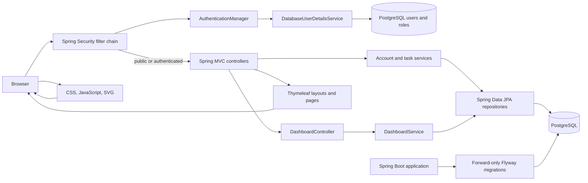

# TASK OS architecture — Phase 3

## Request path

The public surface includes product pages and a guest workspace preview. Authentication and authorization are enforced by the Spring Security filter chain before MVC. Login credentials are verified against the normalized email and password hash loaded from PostgreSQL. The authenticated principal and authorities are kept in a server-managed session. Profile, task, and tag services obtain the account UUID from that principal; clients do not choose the account or task owner being modified.

Spring MVC controllers handle validated form requests and select Thymeleaf pages. `AuthenticatedModelAdvice` supplies a presentation-safe profile view for authenticated navigation. CSS and small JavaScript behaviors are served as static resources. Flyway applies schema changes at startup; Hibernate validates mappings rather than creating tables.

## Package responsibilities

- `com.taskos.TaskOsApplication` starts Spring Boot, component scanning, and audit retention scheduling.
- `com.taskos.auth` owns signup, authentication handlers, password encoding, and audit events.
- `com.taskos.security` configures Spring Security, database-backed authorities, sessions, and login throttling.
- `com.taskos.user` owns account/role entities, persistence, profile forms, preferences, and password changes.
- `com.taskos.web` maps public/workspace pages and shared authentication-aware model attributes.
- `com.taskos.dashboard` builds owner-scoped, read-only task summaries and date views; mutations remain in `TaskController` and `TaskService`.
- `com.taskos.productivity` stores personal methodology classifications and planning records linked to canonical tasks.
- `com.taskos.project` stores private projects, board workflow, canonical task placements, milestones, templates, and project activity.
- `com.taskos.collaboration` owns workspace membership, role authorization, invitations, shared-task assignment/comments, scoped notifications, and workload queries.
- `com.taskos.common` contains feature availability and email canonicalization.
- `com.taskos.config` adds browser security headers.
- `com.taskos.exception` maps invalid input and unexpected failures to safe responses.

## Data boundaries

Public signup can only assign `ROLE_USER`. `/admin/**` requires `ROLE_ADMIN`; no web interface can create or grant an admin. Personal tasks, tags, productivity choices, projects, and project templates are scoped to the authenticated account in server-side queries and services. Collaboration data uses explicit workspace scope and a separate membership role; it does not grant access to personal goals, habits, or time history.

See [authentication.md](authentication.md) for the login sequence and session behavior, [tasks.md](tasks.md) for task persistence and ownership rules, [collaboration.md](collaboration.md) for workspace boundaries, and [dashboard.md](dashboard.md) for dashboard metrics and timezone rules.
